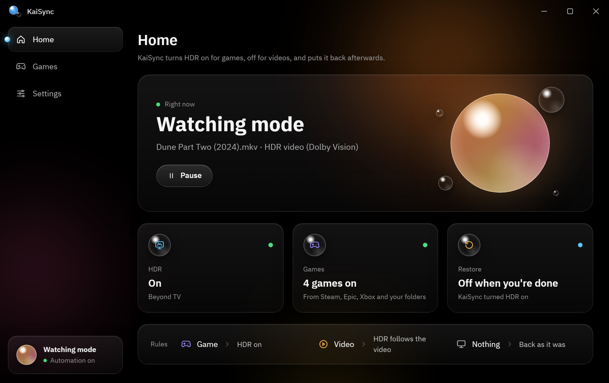
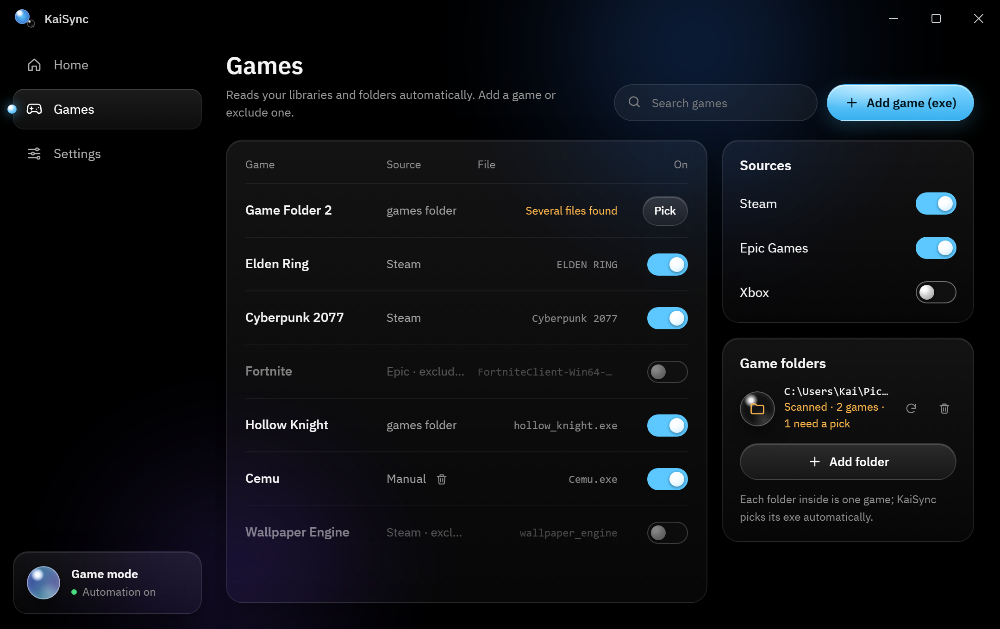
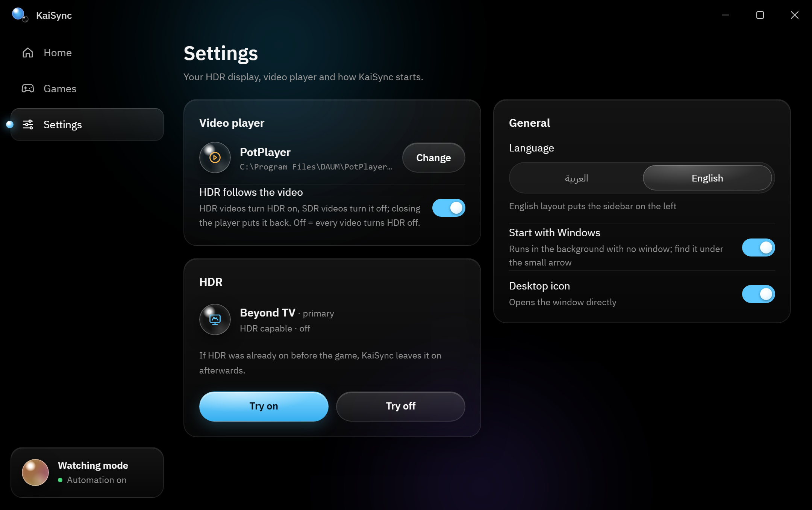
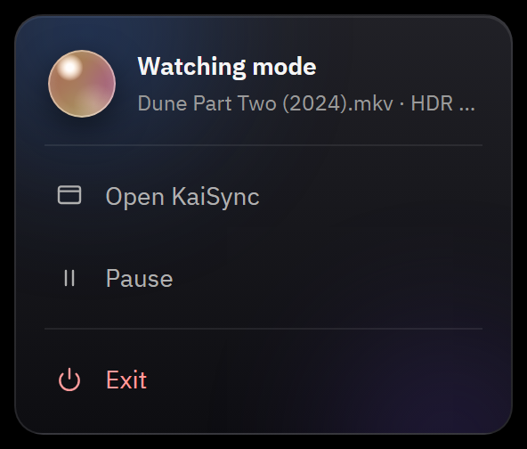
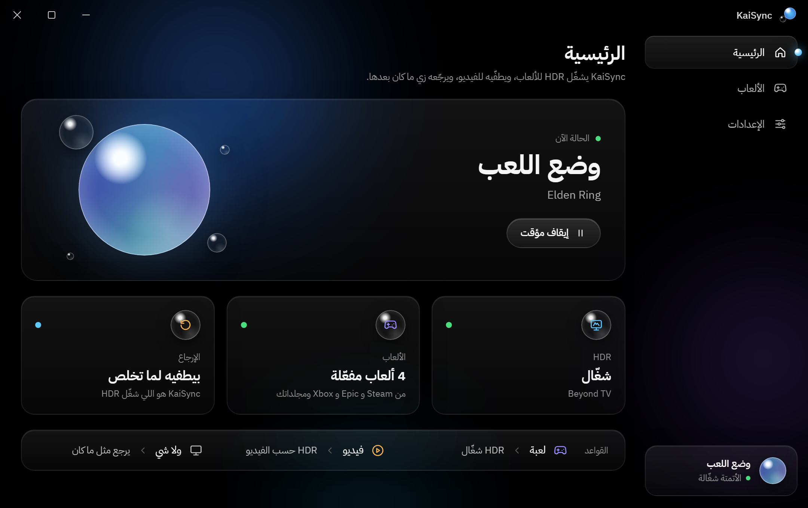

[العربية](README.md) · **English**

# KaiSync

A small Windows 11 tray app that sets **HDR** for you based on what's running: on for games, on or off for videos in PotPlayer depending on the video, and back to how it was when nothing is running.

| What's running | HDR |
|---|---|
| A game | On |
| An HDR video (HDR10, HLG, Dolby Vision) | On |
| An SDR video | Off |
| Nothing | Back as it was. KaiSync only undoes what it changed |

Priority: **game → video → nothing**. If a game is running while PotPlayer is open, HDR stays on.

- **Game detection:** Steam, Epic and Xbox, plus game folders you add (each subfolder is one game; KaiSync picks its exe) and any exe you add yourself. You can exclude any game.
- **HDR follows the video:** KaiSync finds the file open in the player and reads its colour metadata (MKV and MP4). If there is none, it checks the file name for HDR or DV. Turn this off in Settings and every video turns HDR off.
- **Video player:** PotPlayer is found automatically; you can pick any other player.
- **Restore rule:** if HDR was already on before a game, it stays on afterwards; if it was already off before a video, it stays off afterwards. KaiSync remembers this even if it's closed unexpectedly.
- **No admin rights needed.**
- **Interface** in English and Arabic. Logs: `%APPDATA%\KaiSync\logs\`.

---

## Download

Get the latest version from [Releases](https://github.com/kai39x/KaiSync/releases/latest):

| File | Version |
|---|---|
| `KaiSync_1.2.0_x64-setup.exe` | **Installer** (recommended). Installs for the current user without admin rights, adds a Start menu entry, offers a desktop icon, and can be uninstalled from Windows Settings |
| `KaiSync_1.2.0_x64-portable.exe` | **Portable**: a single file that runs without installing. Put it in any folder and run it |

- **First run:** KaiSync registers itself to start with Windows, so it runs in the background with no window. You'll find it under the small arrow next to the clock. You can turn this off in Settings.
- **Portable copy:** it keeps its settings in `%APPDATA%\KaiSync`, same as the installed one. If you move the file, run it once from the new place so the start-with-Windows path is updated.
- **SmartScreen warning:** Windows may show one because the files aren't signed. Click "More info", then "Run anyway".

## Screenshots

| Games | Settings |
|---|---|
|  |  |

| Tray menu | Arabic |
|---|---|
|  |  |

## How to use it

- **Left-click the tray icon:** opens the window.
- **Right-click the tray icon:** opens the menu (Open KaiSync, Pause, Exit).
- **The window's × button:** only hides the window; KaiSync keeps running in the tray.
- **Pause:** stops all automation and doesn't touch HDR. When you resume, KaiSync checks again right away.
- **Exit:** puts HDR back according to the restore rule, then quits.
- **Opening KaiSync while it's already running** (shortcut or Start menu): shows the existing window instead of starting a second copy.

## Notes

- **When HDR turns on:** the moment a game appears or an HDR video starts, with no waiting. Many games (for example Unreal games) and video renderers only check for HDR once, when they start. Turning HDR off waits until the state has held for 3 seconds.
- **If the player doesn't pick up HDR:** close the video and open it again.
- **HDR files with no metadata:** a file with no colour metadata and no HDR or DV in its name is treated as SDR.
- **Windows 11 24H2 and later:** KaiSync uses `GET_ADVANCED_COLOR_INFO_2` / `SET_HDR_STATE`. Older builds use the older advanced-colour API.
- **Off by default:** Wallpaper Engine and Lossless Scaling (Steam), because they run all the time or alongside games. You can turn them on in the Games page.
- **Built with** Tauri 2 (Rust) and React 19.
