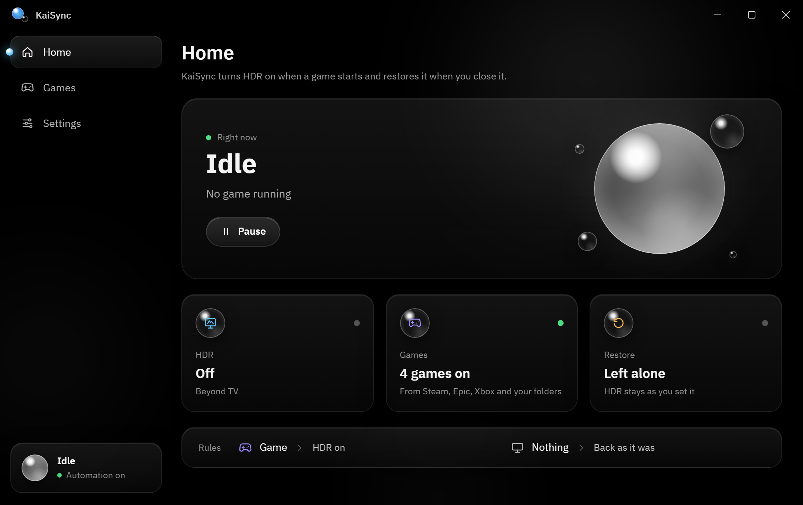
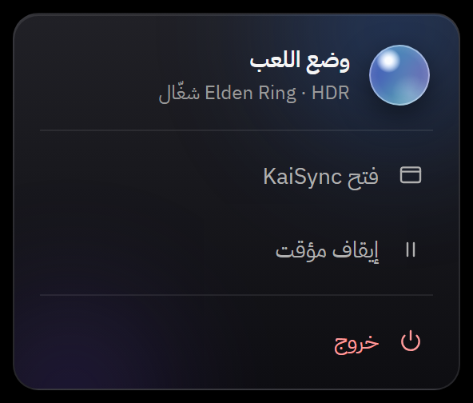

# KaiSync

برنامج صغير لويندوز ١١ يشتغل جنب الساعة. يشغّل **HDR** تلقائياً أول ما تفتح لعبة، ولما تقفلها يرجّعه زي ما كان.

| وش شغّال | HDR |
|---|---|
| لعبة | يشتغل |
| ولا شي | يرجع زي ما كان. KaiSync ما يطفيه إلا إذا كان هو اللي شغّله |

- **اكتشاف الألعاب:** من Steam و Epic و Xbox، ومن مجلدات الألعاب اللي تضيفها، ومن ملفات exe تضيفها يدوياً. وتقدر تستثني أي لعبة.
- **قاعدة الإرجاع:** إذا HDR كان شغّال قبل اللعبة، يبقى شغّال بعدها. والبرنامج يتذكر هالشي حتى لو انقفل فجأة.
- **ما يحتاج صلاحيات مدير.**
- **الواجهة:** بالعربي والإنجليزي، والسجلات في `%APPDATA%\KaiSync\logs\`.

---

## التحميل

حمّل آخر إصدار من صفحة [الإصدارات](https://github.com/kai39x/KaiSync/releases/latest):

| الملف | النسخة |
|---|---|
| `KaiSync_1.0.0_x64-setup.exe` | **نسخة التثبيت** (هذي اللي ننصح فيها). تثبّت للمستخدم الحالي بدون صلاحيات مدير، وتضيف البرنامج لقائمة ابدأ، وتقدر تسوي أيقونة على سطح المكتب، وتقدر تحذفه من إعدادات ويندوز |
| `KaiSync_1.0.0_x64-portable.exe` | **نسخة بورتبل**: ملف واحد يشتغل على طول بدون تثبيت. حطه في المجلد اللي تبيه وشغّله |

- **أول تشغيل:** يسجّل البرنامج نفسه في التشغيل مع الويندوز، فيشتغل بالخلفية بدون نافذة، وتلقاه في السهم الصغير جنب الساعة. وتقدر تطفي هالخيار من الإعدادات.
- **النسخة البورتبل:** إعداداتها في `%APPDATA%\KaiSync` مثل نسخة التثبيت. لو نقلت الملف لمكان ثاني، شغّله مرة من المكان الجديد عشان يتحدّث مسار التشغيل مع الويندوز.
- **ويندوز ممكن يعرض تحذير SmartScreen:** لأن الملف ما هو موقّع. اضغط "مزيد من المعلومات" وبعدها "تشغيل على أي حال".

## الواجهة

| الألعاب | الإعدادات |
|---|---|
|  |  |

| English | قائمة الأيقونة جنب الساعة |
|---|---|
|  |  |

## طريقة الاستخدام

- **زر الماوس اليسار على الأيقونة جنب الساعة:** يفتح النافذة.
- **زر الماوس اليمين على الأيقونة:** يفتح القائمة: فتح KaiSync، إيقاف مؤقت، خروج.
- **زر × في النافذة:** يخفيها بس، والبرنامج يكمل شغله جنب الساعة.
- **الإيقاف المؤقت:** يوقف كل شي وما يلمس HDR. ولما تستأنف، يفحص على طول.
- **الخروج:** يرجّع HDR حسب القاعدة، وبعدها يقفل.
- **لو فتحت البرنامج وهو شغّال أصلاً:** من الاختصار أو من قائمة ابدأ، يفتح لك النافذة الموجودة بدل ما يشغّل نسخة ثانية.

## ملاحظات

- **متى يشتغل HDR:** أول ما تظهر اللعبة، بدون انتظار. السبب إن ألعاب كثيرة، مثل ألعاب Unreal، تفحص HDR مرة وحدة بس وقت ما تشتغل. أما إطفاؤه فما يصير إلا إذا بقت اللعبة مقفولة ٣ ثواني.
- **ويندوز ١١ نسخة 24H2 وأحدث:** يستخدم `GET_ADVANCED_COLOR_INFO_2` / `SET_HDR_STATE`. والنسخ الأقدم تستخدم الطريقة القديمة.
- **برامج مطفية من البداية:** Wallpaper Engine و Lossless Scaling من Steam، لأنها تشتغل طول الوقت أو مع الألعاب. وتقدر تفعّلها من صفحة الألعاب.
- **مبني بـ:** Tauri 2 (Rust) و React 19.
