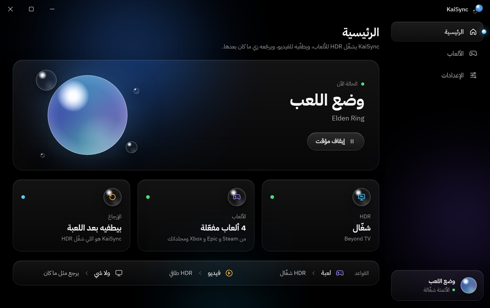
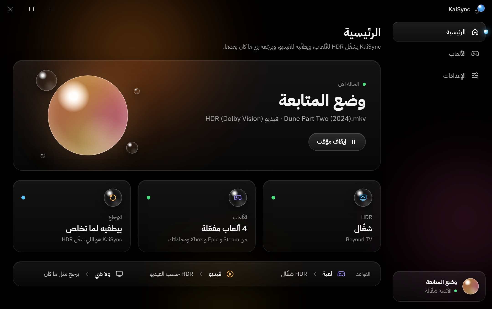
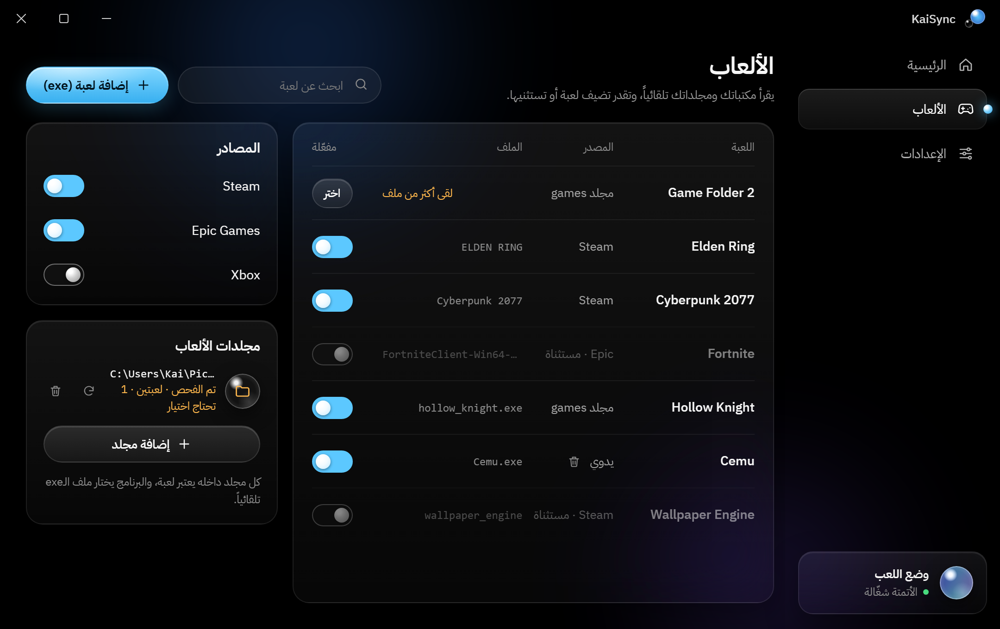
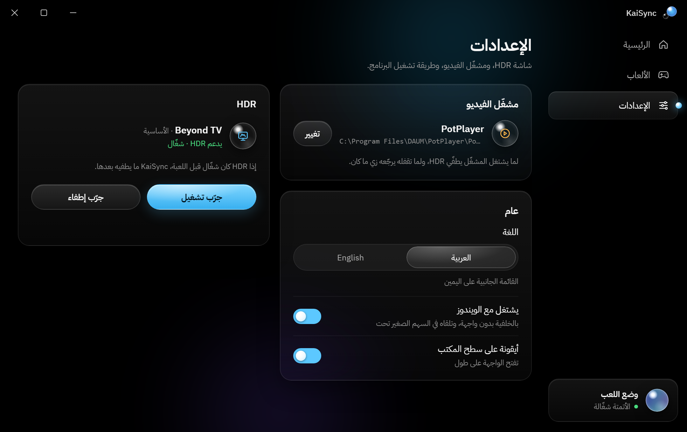

**العربية** · [English](README.en.md)

# KaiSync

برنامج صغير لويندوز ١١ يشتغل جنب الساعة، ويضبط **HDR** لحاله على حسب اللي شغّال عندك:
- **لعبة:** يشغّل HDR.
- **فيديو في PotPlayer:** يشغّله أو يطفّيه على حسب نوع الفيديو.
- **ولا شي:** يرجّعه زي ما كان.

| وش شغّال | HDR |
|---|---|
| لعبة | يشتغل |
| فيديو HDR (HDR10 أو HLG أو Dolby Vision) | يشتغل |
| فيديو عادي (SDR) | ينطفي |
| ولا شي | يرجع زي ما كان. KaiSync يرجّع بس اللي غيّره هو |

الأولوية: **لعبة ← فيديو ← ولا شي**. يعني لو فيه لعبة شغّالة وPotPlayer مفتوح، HDR يبقى شغّال.

- **اكتشاف الألعاب:** من Steam و Epic و Xbox، ومن مجلدات الألعاب اللي تضيفها، ومن ملفات exe تضيفها يدوياً. وتقدر تستثني أي لعبة.
- **HDR حسب الفيديو:** KaiSync يعرف وش الملف المفتوح في المشغّل، ويقرأ معلومات الألوان من داخل ملفات MKV و MP4. لو ما لقى معلومات، يشوف إذا اسم الملف فيه HDR أو DV. وتقدر تطفي هالخيار من الإعدادات، وقتها يطفّي HDR مع أي فيديو.
- **مشغّل الفيديو:** يلقى PotPlayer لحاله، وتقدر تختار أي مشغّل ثاني.
- **قاعدة الإرجاع:**
  - إذا HDR كان شغّال قبل اللعبة، يبقى شغّال بعدها.
  - إذا كان طافي قبل الفيديو، يبقى طافي بعده.
  - البرنامج يتذكر هالشي حتى لو انقفل فجأة.
- **ما يحتاج صلاحيات مدير.**
- **الواجهة:** بالعربي والإنجليزي، والسجلات في `%APPDATA%\KaiSync\logs\`.

---

## التحميل

حمّل آخر إصدار من صفحة [الإصدارات](https://github.com/kai39x/KaiSync/releases/latest):

| الملف | النسخة |
|---|---|
| `KaiSync_1.2.1_x64-setup.exe` | **نسخة التثبيت** (هذي اللي ننصح فيها). تثبّت للمستخدم الحالي بدون صلاحيات مدير، وتضيف البرنامج لقائمة ابدأ، وتقدر تسوي أيقونة على سطح المكتب، وتقدر تحذفه من إعدادات ويندوز |
| `KaiSync_1.2.1_x64-portable.exe` | **نسخة بورتبل**: ملف واحد يشتغل على طول بدون تثبيت. حطه في المجلد اللي تبيه وشغّله |

- **أول تشغيل:** يسجّل البرنامج نفسه في التشغيل مع الويندوز، فيشتغل بالخلفية بدون نافذة، وتلقاه في السهم الصغير جنب الساعة. وتقدر تطفي هالخيار من الإعدادات.
- **النسخة البورتبل:** إعداداتها في `%APPDATA%\KaiSync` مثل نسخة التثبيت. لو نقلت الملف لمكان ثاني، شغّله مرة من المكان الجديد عشان يتحدّث مسار التشغيل مع الويندوز.
- **ويندوز ممكن يعرض تحذير SmartScreen:** لأن الملف ما هو موقّع. اضغط "مزيد من المعلومات" وبعدها "تشغيل على أي حال".

## الواجهة

| فيديو HDR | الألعاب |
|---|---|
|  |  |

| الإعدادات | قائمة الأيقونة جنب الساعة |
|---|---|
|  |  |

## طريقة الاستخدام

- **زر الماوس اليسار على الأيقونة جنب الساعة:** يفتح النافذة.
- **زر الماوس اليمين على الأيقونة:** يفتح القائمة: فتح KaiSync، إيقاف مؤقت، خروج.
- **زر × في النافذة:** يخفيها بس، والبرنامج يكمل شغله جنب الساعة.
- **الإيقاف المؤقت:** يوقف كل شي وما يلمس HDR. ولما تستأنف، يفحص على طول.
- **الخروج:** يرجّع HDR حسب القاعدة، وبعدها يقفل.
- **لو فتحت البرنامج وهو شغّال أصلاً:** من الاختصار أو من قائمة ابدأ، يفتح لك النافذة الموجودة بدل ما يشغّل نسخة ثانية.

## ملاحظات

- **متى يشتغل HDR:** أول ما تظهر اللعبة أو يبدأ فيديو HDR، بدون انتظار. السبب إن ألعاب كثيرة، مثل ألعاب Unreal، والمشغّلات بعد، تفحص HDR مرة وحدة بس وقت ما تبدأ. أما إطفاؤه فما يصير إلا إذا بقت الحالة ٣ ثواني.
- **لو المشغّل ما حسّ بـ HDR:** اقفل الفيديو وافتحه مرة ثانية.
- **ملف HDR بدون معلومات:** إذا ما فيه معلومات ألوان، واسمه ما فيه HDR ولا DV، KaiSync بيعتبره فيديو عادي.
- **ويندوز ١١ نسخة 24H2 وأحدث:** يستخدم `GET_ADVANCED_COLOR_INFO_2` / `SET_HDR_STATE`. والنسخ الأقدم تستخدم الطريقة القديمة.
- **برامج مطفية من البداية:** Wallpaper Engine و Lossless Scaling من Steam، لأنها تشتغل طول الوقت أو مع الألعاب. وتقدر تفعّلها من صفحة الألعاب.
- **مبني بـ:** Tauri 2 (Rust) و React 19.
